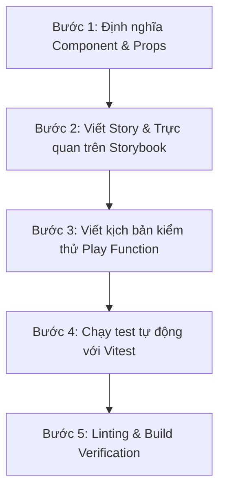

# Quy trình phát triển Component: Storybook, Testing & Workflow

Tài liệu này hướng dẫn chi tiết quy trình tiêu chuẩn để xây dựng, trực quan hóa trên Storybook, kiểm thử tự động (Interaction / Unit Testing) và quản lý chất lượng mã nguồn cho các UI Component trong dự án Next.js.

---

## 1. Kiến trúc thư mục (Co-location Architecture)

Mỗi component được tổ chức theo nguyên tắc **Co-location** (mọi tài nguyên liên quan nằm chung một thư mục):

```
src/components/ui/button/
├── Button.tsx           # Mã nguồn Component chính (React + Tailwind CSS)
├── Button.stories.tsx   # Định nghĩa Stories + Kịch bản kiểm thử tương tác (Play functions)
└── index.ts             # Public API & Types export
```

### Ưu điểm:
- **Độc lập và tự đóng gói (Self-contained)**: Dễ dàng mở rộng, tái sử dụng hoặc refactor mà không làm ảnh hưởng đến các phần khác.
- **Storybook & Test đi liền với code**: Developer khi sửa code sẽ thấy ngay câu chuyện và bài test liên quan.
- **Export tinh gọn**: `index.ts` chỉ export những gì cần dùng ra bên ngoài.

---

## 2. Component mẫu: `Button`

Component [Button.tsx](file:///Users/mn20/Projects/Test/src/components/ui/button/Button.tsx) được thiết kế theo tiêu chuẩn công nghiệp:
- **Variants**: `primary`, `secondary`, `outline`, `ghost`, `destructive`, `link`.
- **Sizes**: `sm`, `md`, `lg`, `icon`.
- **States**: `isLoading` (hiển thị spinner, tự động đặt `aria-busy="true"` và ngăn chặn click), `disabled`.
- **Accessibility**: Hỗ trợ đầy đủ focus ring trực quan (`focus-visible:ring-2`), semantic HTML `<button>`, và ARIA attributes.
- **Styling**: Sử dụng Tailwind CSS v4 tối ưu dung lượng và tốc độ.

---

## 3. Storybook: Phát triển & Trực quan hóa

Storybook đóng vai trò là môi trường cách ly (isolated sandbox) để phát triển và kiểm tra mọi trạng thái của component mà không cần chạy toàn bộ ứng dụng Next.js.

### Lệnh khởi chạy
```bash
# Chạy Storybook dev server trên cổng 6006
npm run storybook
```

### Các tính năng đã tích hợp:
1. **Autodocs**: Tự động sinh trang tài liệu hướng dẫn và bảng thuộc tính (Props Table) từ JSDoc và TypeScript.
2. **Controls Panel**: Cho phép thay đổi props (`variant`, `size`, `isLoading`, `disabled`) trực tiếp trên trình duyệt.
3. **Accessibility (a11y) Addon**: Tự động quét và cảnh báo các lỗi vi phạm tiêu chuẩn WCAG.
4. **Tailwind CSS Integration**: Tích hợp trực tiếp `globals.css` thông qua `.storybook/preview.tsx`.

---

## 4. Kiểm thử tự động (Storybook Play Functions + Vitest)

Hệ thống kiểm thử kết hợp giữa **Storybook Component Stories** và **Vitest Browser Runner** (chạy Playwright Chromium không đầu):

### Kịch bản kiểm thử tương tác trong Stories
Trong [Button.stories.tsx](file:///Users/mn20/Projects/Test/src/components/ui/button/Button.stories.tsx):
- **`InteractiveClickTest`**: Sử dụng `userEvent.click()` và hàm `fn()` để xác minh sự kiện click được kích hoạt chính xác 1 lần.
- **`InteractiveLoadingTest`**: Xác minh thuộc tính `aria-busy`, trạng thái `disabled`, sự xuất hiện của icon loading spinner, và thuộc tính `pointer-events: none` ngăn ngừa click khi đang xử lý.

### Chạy kiểm thử từ Terminal
```bash
# Chạy toàn bộ test suite một lần (dành cho CI/CD hoặc trước khi commit)
npm test

# Chạy test ở chế độ watch (tự động chạy lại khi thay đổi code)
npm run test:watch
```

---

## 5. Quy trình 5 bước phát triển Component mới

Khi cần tạo thêm component mới (ví dụ: `Input`, `Card`, `Badge`):



### Chi tiết các bước:
1. **Bước 1**: Tạo thư mục `src/components/ui/<tên-component>/` chứa file component chính và file type.
2. **Bước 2**: Tạo `<TênComponent>.stories.tsx` với cấu hình meta, autodocs và các variants thông dụng.
3. **Bước 3**: Viết story kiểm thử tương tác (play function) để mô phỏng hành vi của người dùng (`click`, `type`, `focus`).
4. **Bước 4**: Chạy `npm test` để xác minh tất cả assertions đều vượt qua trên môi trường trình duyệt thực.
5. **Bước 5**: Chạy bộ lệnh kiểm tra toàn diện:
   ```bash
   npm run lint        # Đảm bảo quy chuẩn ESLint không có lỗi
   npm test            # Đảm bảo 100% tests vượt qua
   npm run build       # Đảm bảo Next.js compile thành công
   npm run build-storybook # Đảm bảo build tĩnh của Storybook sẵn sàng deploy
   ```

---

## 6. Mẫu cấu hình CI Pipeline (GitHub Actions)

Để tích hợp tự động vào luồng CI/CD, có thể tạo file `.github/workflows/ci.yml`:

```yaml
name: CI Quality Gate

on:
  push:
    branches: [main]
  pull_request:
    branches: [main]

jobs:
  validate:
    runs-on: ubuntu-latest
    steps:
      - uses: actions/checkout@v4
      - uses: actions/setup-node@v4
        with:
          node-version: 20
          cache: 'npm'

      - name: Install dependencies
        run: npm ci

      - name: Install Playwright Browsers
        run: npx playwright install chromium --with-deps

      - name: Lint Code
        run: npm run lint

      - name: Run Component & Interaction Tests
        run: npm test

      - name: Build Next.js Application
        run: npm run build

      - name: Build Storybook Static Site
        run: npm run build-storybook
```
