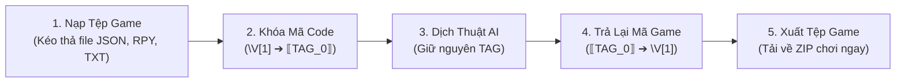

# Giai Đoạn 1: Nền Tảng Dịch Thuật Game (Không Làm Hỏng Game)

> **Tóm tắt trong 1 câu (TL;DR):**  
> Tự động nhận diện game (RPG Maker, Ren'Py, Unity), trích xuất câu thoại, bảo vệ an toàn các biến code/mã màu (`\V[1]`, `{i}`) để dịch sang tiếng Việt mà **không làm crash game**, sau đó đóng gói lại thành file patch sẵn sàng chơi.

---

## 1. 🛑 Vấn Đề Thực Tế (Trước Khi Có Hệ Thống Này)

Khi người chơi hoặc nhóm dịch tự dịch game bằng Google Dịch hoặc ChatGPT thông thường:

```text
Câu gốc trong game RPG Maker:
"Welcome to Eldoria village, brave traveler! Take this \V[1] Gold."
(Trong đó \V[1] là biến hiển thị số tiền trong game).

❌ Dịch máy thông thường:
"Chào mừng đến làng Eldoria! Hãy nhận lấy \ V [ 1 ] Vàng."
(AI tự ý chèn dấu cách vào \V[1], hoặc dịch luôn chữ 'V' thành chữ khác).

💥 HẬU QUẢ: 
Khi mở game lên chơi, engine game không đọc được mã \V[1] ➔ Game bị văng lỗi (Crash to Desktop), màn hình đen hoặc lỗi tràn khung thoại.
```

---

## 2. ✨ Giải Pháp Của Chúng Ta (Sau Khi Có Hệ Thống)

| Tiêu Chí | Dịch Thủ Công / Tool Cũ | GameLingo AI Studio (Giai Đoạn 1) |
| :--- | :--- | :--- |
| **Nhận diện Engine** | Phải tự tìm hiểu xem game làm bằng RPG Maker hay Ren'Py | Kéo thả tệp vào là hệ thống **tự nhận diện 100%** |
| **Bảo vệ mã game (`\V[1]`, `{b}`)** | Dễ bị AI dịch nhầm, xóa mất mã màu hoặc biến | **Tag Guard**: Khóa chặt các mã code thành thẻ bảo vệ, AI không thể đụng vào |
| **Dịch nguyên câu** | Thường bị dịch nửa Anh nửa Việt (dịch chắp vá từng từ) | Dịch trọn câu tự nhiên, thuần Việt, mượt mà |
| **Đóng gói game** | Phải tự copy-paste thủ công hàng nghìn file vào đúng thư mục | **1-Click Tải ZIP Patch**: Chỉ việc giải nén đè vào thư mục game là chơi được ngay |

---

## 3. 🔄 Cách Hệ Thống Hoạt Động Trong 3 Bước Đơn Giản



1. **Bước 1 - Nhận diện & Trích xuất:** Đọc file game, tìm đúng những câu thoại của NPC (bỏ qua các dòng lệnh logic lập trình).
2. **Bước 2 - Tạm thời "giấu" mã code (Tag Masking):** 
   - Biến `\V[1]` được tạm thay bằng `⟦TAG_0⟧`.
   - AI dịch câu: `"Chào mừng đến làng Eldoria! Hãy nhận lấy ⟦TAG_0⟧ Vàng."`
3. **Bước 3 - Mở khóa & Đóng gói:** Đổi `⟦TAG_0⟧` trở lại thành `\V[1]` và xuất tệp game nguyên vẹn.

---

## 4. 🎮 Hướng Dẫn Sử Dụng Trên Giao Diện

1. **Chọn Dự Án Mẫu hoặc Tải File Game Lên:**
   - Bấm vào các nút mẫu sẵn có: *RPG Maker MV/MZ*, *Ren'Py Visual Novel*, hoặc *RPG Maker 100 câu*.
   - Hoặc kéo thả thư mục chứa game của bạn vào ô nạp tệp.
2. **Xem và Hiệu Chỉnh Câu Thoại:**
   - Cột bên trái: Câu tiếng Anh/tiếng Nhật gốc của game.
   - Cột bên phải: Ô nhập bản dịch tiếng Việt.
   - Có thanh cảnh báo màu vàng nếu câu dịch quá dài (tránh bị tràn ra ngoài khung thoại game).
3. **Bấm Nút "⚡ Dịch Toàn Bộ":** Hệ thống sẽ tự động dịch các câu chưa dịch.
4. **Bấm "📦 Tải Bản Vá (ZIP)":** Tải file về và dán vào thư mục game để trải nghiệm.

---

## 5. 💻 Dành Cho Lập Trình Viên (Cấu Trúc Mã Nguồn)

* **Bộ nhận diện engine:** [`src/lib/game-translator/detector.ts`](file:///Users/mn20/Projects/Test/src/lib/game-translator/detector.ts)
  * Quét tên file và cấu trúc thư mục (ví dụ `data/System.json` ➔ RPG Maker MV/MZ; `game/script.rpy` ➔ Ren'Py).
* **Bộ trích xuất và bảo vệ thẻ:** [`src/lib/game-translator/adapters/rpgmaker.ts`](file:///Users/mn20/Projects/Test/src/lib/game-translator/adapters/rpgmaker.ts)
  * Quét các mã lệnh `code: 401` (Hội thoại) và `code: 102` (Lựa chọn trả lời).
  * Hàm `maskGameTags` và `unmaskGameTags` dùng regex loại bỏ trùng lặp thẻ (`getNonOverlappingMatches`).
* **Trình dịch trực tuyến miễn phí:** [`src/lib/game-translator/web-free-translator.ts`](file:///Users/mn20/Projects/Test/src/lib/game-translator/web-free-translator.ts)
  * Cung cấp khả năng dịch câu tự nhiên, zero-config không cần API key.
