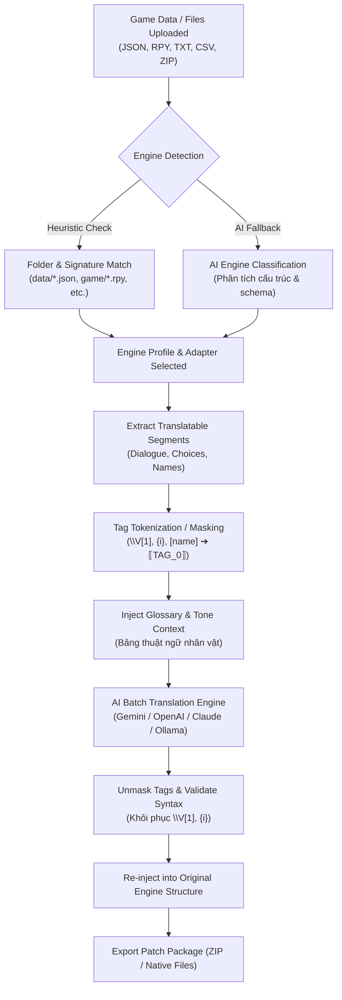
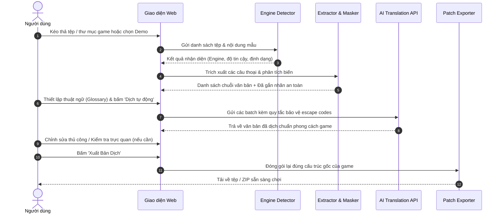
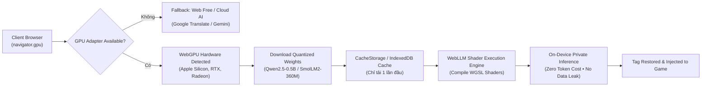

# Giai Đoạn 1: Nền Tảng Dịch Thuật Game Đa Framework (Game Translation Platform)

Tài liệu kỹ thuật Phase 1 cho hệ thống dịch thuật game đa engine với nhận diện tự động bằng AI và Heuristic Rules.

---

## 1. Mục tiêu (Objectives)

1. **Nhận diện tự động Engine game**: Tự động phát hiện framework game (RPG Maker MV/MZ/XP/VX, Ren'Py, Unity, Godot, Generic Localization) thông qua kiểm tra cấu trúc thư mục, định dạng tệp và phân tích ngữ nghĩa AI.
2. **Trích xuất & Bảo toàn Tag/Biến (Safe Code Extraction)**: Trích xuất chính xác các chuỗi văn bản hội thoại mà không làm hỏng các biến game, mã màu, escape codes (`\v[1]`, `\c[2]`, `{i}...{/i}`, `[player_name]`, `%s`, `{0}`).
3. **Dịch thuật AI với Ngữ cảnh & Thuật ngữ (Contextual Game AI Translation)**:
   - Hỗ trợ dịch hàng loạt với bảo vệ tag (tag masking/tokenization).
   - Tích hợp bảng thuật ngữ (Glossary/Dictionary) giúp đồng nhất tên nhân vật, địa danh, kỹ năng.
   - Tùy chỉnh văn phong game (Kiếm hiệp, Kỳ ảo RPG, Visual Novel, Hài hước, Đời thường).
   - Hỗ trợ đa nhà cung cấp AI: Google Gemini, OpenAI, Claude, DeepSeek, Local Ollama, cùng chế độ Offline/Demo có sẵn.
4. **Tái đóng gói & Xuất tệp tương thích ngược (Re-injection & Packaging)**:
   - Ghi đè hoặc sinh tệp bản địa hóa chuẩn xác theo đúng cấu trúc của từng engine.
   - Tải về tệp lẻ hoặc nén ZIP toàn bộ bản vá việt hóa/bản dịch để chép trực tiếp vào thư mục game.
5. **Dữ liệu mẫu có sẵn (Built-in Demo Datasets)**: Cho phép thử nghiệm ngay lập tức với các mẫu RPG Maker, Ren'Py và Unity chỉ với một cú click.

---

## 2. Kiến Trúc Hệ Thống (System Architecture)

```
┌────────────────────────────────────────────────────────────────────────┐
│                          User Interface (Web)                          │
│  - Drag & Drop Files / Folder / Zip                                    │
│  - Engine Recognition & Confidence Monitor                             │
│  - Dual-pane Translation Editor (Source vs Translated)                 │
│  - Engine Tag Inspector & Character Glossary Manager                   │
│  - AI Provider Configuration & Tone Selector                           │
└──────────────────┬─────────────────────────────────┬───────────────────┘
                   │                                 │
                   ▼                                 ▼
┌─────────────────────────────────────┐   ┌──────────────────────────────┐
│       Engine Detector Subsystem     │   │      Glossary & Memory       │
│  - Fast Pattern Heuristic Engine    │   │  - Character/Item Dictionary │
│  - File Structure Tree Profiler     │   │  - Tag Guard & Masker        │
│  - AI Semantic Engine Identifier    │   │  - Escape Code Preservation  │
└──────────────────┬──────────────────┘   └──────────────┬───────────────┘
                   │                                     │
                   ▼                                     ▼
┌────────────────────────────────────────────────────────────────────────┐
│                   Extractor & Injector Adapters                        │
│  ┌─────────────────────────┬─────────────────────────┬──────────────┐  │
│  │ RPG Maker MV/MZ (JSON)  │ Ren'Py (.rpy / tl)      │ Unity / CSV  │  │
│  │ Event Code 401/102/108  │ String Dialogue & Tags  │ Text / i2loc │  │
│  └─────────────────────────┴─────────────────────────┴──────────────┘  │
└──────────────────┬─────────────────────────────────┬───────────────────┘
                   │                                 │
                   ▼                                 ▼
┌─────────────────────────────────────┐   ┌──────────────────────────────┐
│        AI Translation Service       │   │   Export & Patch Packager    │
│  - Google Gemini / OpenAI / Claude  │   │  - Zero-dep ZIP Builder      │
│  - System Prompt with Game Rules    │   │  - In-place File Injector    │
│  - Segment Batching & Token Guard   │   │  - Game Ready Patch Archive  │
└─────────────────────────────────────┘   └──────────────────────────────┘
```

---

## 3. Sơ Đồ Luồng Dữ Liệu & Quy Trình (Mermaid Diagrams)

### 3.1. Data Pipeline (Đường Ống Dữ Liệu Từ Game Đến Bản Dịch)



### 3.2. Sequence Flow (Trình Tự Tương Tác Của Người Dùng)



---

## 4. Chi Tiết Đặc Tả Kỹ Thuật Các Engine (Engine Specifications)

| Engine | Nhận Diện (Heuristics & Signatures) | Tệp Nguồn | Mã Thoại / Cơ Chế Trích Xuất | Lưu Ý Đặc Biệt |
|---|---|---|---|---|
| **RPG Maker MV/MZ** | Thư mục `data/`, có `System.json`, `Actors.json`, `MapXXX.json` | JSON UTF-8 | Code `401` (Show Text), `102` (Choices), `108` (Comment), `356` (Plugin) | Giữ nguyên thứ tự parameters và cấu trúc mảng event |
| **Ren'Py** | Thư mục `game/`, tệp `*.rpy`, có `define e = Character(...)` | Python/RPY script | `character "dialogue"`, `old "..." new "..."` | Giữ nguyên cú pháp tag `{i}`, `{b}`, `{size}`, `[variable]` |
| **Unity (Text/Mod)** | Tệp `_AutoGeneratedTranslations.txt`, thư mục `StreamingAssets`, `I2/Localization` | TXT, CSV, JSON | Key-value (`original=translated`) hoặc cột bản địa hóa | Giữ nguyên format placeholder `{0}`, `%s`, `\n` |
| **Generic / Unknown** | Khác biệt cấu trúc hoặc định dạng tùy biến | JSON, CSV, PO, TXT | Nhờ AI nhận diện khóa văn bản dịch so với khóa logic | Tự động phân loại bằng AI Prompt |

---

## 5. Quy Chuẩn Kỹ Thuật (TypeScript & Ponytail Rules)

- **Zero `any`**: Tuyệt đối không dùng `any`, `any[]`, `as any`. Sử dụng Discriminated Unions cho các loại Engine và AST token.
- **Tái sử dụng tối đa**: Tận dụng hệ thống Tailwind v4, useTheme, useLanguage và các UI components có sẵn trong `src/components/ui`.
- **Kiểm thử tự động**: Có bộ kiểm thử độc lập cho bộ trích xuất/nhận diện engine và bảo toàn escape code.

---

## 6. Tối Ưu Hóa & Xử Lý Nội Dung Dịch Chưa Sạch (Clean Translation & Tag Guard Overlap Fix)

1. **Khắc phục lỗi nhận diện trùng lặp thẻ (Tag Overlap Discarding)**:
   - *Nguyên nhân*: Thẻ RPG Maker `\V[1]` trước đây bị biểu thức regex `[player_name]` nhận diện đúp phần ruột `[1]`, làm hiển thị hai thẻ tách rời `\V[1]` và `[1]`.
   - *Giải pháp*: Thuật toán `getNonOverlappingMatches` sắp xếp thứ tự và loại bỏ toàn bộ các match con bị bao bọc bên trong thẻ dài hơn. Đồng thời siết chặt regex biến Ren'Py thành `\[[a-zA-Z_][a-zA-Z0-9_.]*\]` (loại trừ số thuần túy).

2. **Dịch trọn câu sạch 100% tiếng Việt (Full-Sentence Translation)**:
   - *Nguyên nhân*: Cơ chế mock trước đây dùng từ điển thay thế từng từ lẻ (`Welcome` ➔ `Chào mừng`, `Gold` ➔ `Vàng`), để sót phần còn lại bằng tiếng Anh (`Chào mừng to Eldoria village, brave traveler! Take this \V[1] Vàng.`).
   - *Giải pháp*:
     - Tích hợp engine dịch trực tuyến miễn phí `web_free` (Google Translate API) xử lý nguyên câu tự nhiên, kết nối liền mạch mà không cần API key.
     - Xây dựng kho ngữ liệu câu thoại hoàn chỉnh `OFFLINE_SENTENCE_CATALOG` cho môi trường không có internet.
     - Siết chặt System Prompt cho các mô hình LLM (Gemini, OpenAI, DeepSeek, Claude) bắt buộc dịch 100% trọn vẹn ngữ nghĩa game, tuyệt đối không để lẫn từ tiếng Anh.
---

## 7. Tích Hợp Mô Hình AI Chạy Bằng WebGPU (On-Device WebGPU AI Pipeline)

### 7.1. Kiến Trúc Khai Thác GPU Trực Tiếp (Zero-Server WebGPU Pipeline)



### 7.2. Đặc Tả Kỹ Thuật WebGPU

1. **Phần cứng & Trình duyệt hỗ trợ**:
   - Tự động kiểm tra `navigator.gpu.requestAdapter()` để hiển thị thông tin GPU người dùng (Vendor, Architecture, Driver).
   - Hỗ trợ tốt trên Chrome 113+, Edge 113+, Safari 18+ (macOS, Windows, Linux, Android).
2. **Các mô hình tối ưu sẵn**:
   - `Qwen2.5-0.5B-Instruct-q4f16_1-MLC` (~380 MB): Khuyên dùng cho tiếng Việt và đa ngôn ngữ, tốc độ 50-80 token/giây trên chip Apple M-series hoặc card rời.
   - `SmolLM2-360M-Instruct-q4f16_1-MLC` (~230 MB): Mô hình siêu nhẹ cho GPU tích hợp (Intel iGPU / mobile).
   - `Llama-3.2-1B-Instruct-q4f16_1-MLC` (~780 MB): Chất lượng văn phong phong phú hơn cho các đoạn hội thoại phức tạp.
3. **Cơ chế tải động và Quản lý bộ nhớ VRAM**:
   - Nạp động qua module ESM runtime tại client, giữ gói Next.js build cực kỳ tinh gọn.
   - Hiển thị thanh tiến trình % tải trọng lượng mô hình (weights) và trạng thái VRAM theo thời gian thực.
   - Cung cấp nút giải phóng bộ nhớ `unload` khi người dùng chuyển sang engine khác.
