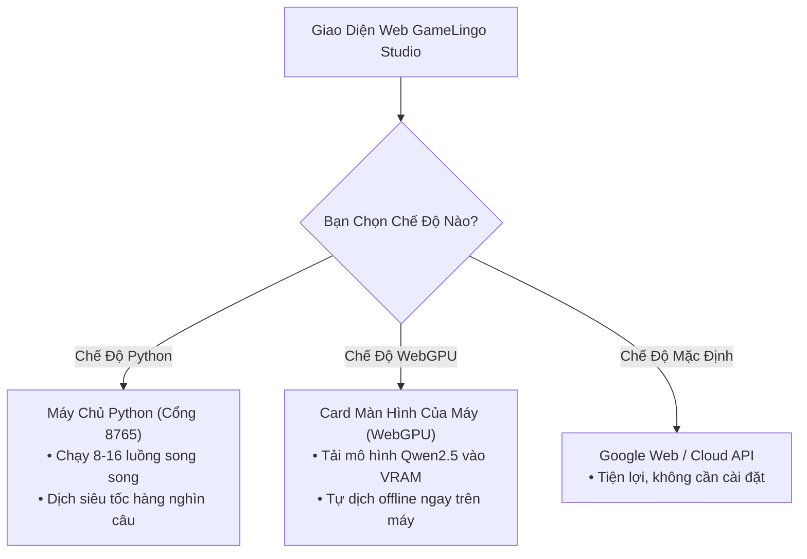

# Giai Đoạn 2: Tăng Tốc Dịch Thuật Bằng Python & WebGPU

> **Tóm tắt trong 1 câu (TL;DR):**  
> Khi game có hàng chục nghìn câu thoại, dịch từng câu trên trình duyệt sẽ rất chậm hoặc tốn tiền mua API. Giai đoạn 2 bổ sung **2 động cơ tăng tốc**: **Python chạy ngầm** (dịch đa luồng 50–100 câu/giây) và **WebGPU** (dùng card màn hình máy tính để dịch AI offline miễn phí).

---

## 1. 🛑 Vấn Đề Thực Tế (Trước Khi Có Hệ Thống Này)

Game nhập vai (RPG) thường có từ **5.000 đến 50.000 câu thoại**:

```text
❌ Cách dịch thông thường trên Web:
- Trình duyệt chỉ gửi lần lượt từng câu ➔ Dịch 5.000 câu mất hơn 1 tiếng đồng hồ!
- Nếu gọi API đám mây (OpenAI / Gemini) ➔ Tốn tiền token đáng kể cho game dài.
- Trình duyệt dễ bị đơ, giật lag nếu phải xử lý khối lượng tệp quá lớn.
```

---

## 2. ✨ Giải Pháp Của Chúng Ta (Sau Khi Có Hệ Thống)

Chúng ta cung cấp thêm **2 chế độ tăng tốc** tùy theo nhu cầu của bạn:

| Chế Độ Dịch | Tốc Độ | Chi Phí | Ưu Điểm Chính |
| :--- | :--- | :--- | :--- |
| **1. Python Accelerator** (Mặc định khuyên dùng) | 🚀 **50 – 100 câu/giây** (Cực nhanh) | Miễn phí | Tận dụng CPU đa nhân trên máy tính, dịch cả nghìn câu trong vài giây |
| **2. WebGPU On-Device** | ⚡ **30 – 60 token/giây** | Miễn phí | Chạy mô hình AI mini trực tiếp trên Card màn hình (GPU), **100% riêng tư, không cần mạng** |
| **3. Web Miễn Phí (Google Web)** | 🌐 3 – 5 câu/giây | Miễn phí | Không cần cài đặt gì, mở web là dùng được ngay |
| **4. Cloud AI (Gemini / GPT-4o)** | 🧠 10 – 20 câu/giây | Dùng API Key | Văn phong thông minh nhất cho các đoạn kịch bản khó |

---

## 3. 🔄 Cách Hoạt Động Cực Kỳ Dễ Hiểu



* **Nếu bạn bật Python:** Web gửi gói 50 câu sang máy chủ Python cục bộ ➔ Python chia việc cho 8 hoặc 16 nhân CPU cùng dịch một lúc ➔ Trả kết quả về ngay lập tức.
* **Nếu bạn chưa bật Python:** Web tự động chuyển sang chế độ bình thường, **không bao giờ bị báo lỗi làm gián đoạn trải nghiệm**.

---

## 4. 🎮 Hướng Dẫn Sử Dụng

### Cách 1: Sử dụng máy chủ Python để tăng tốc tối đa
1. Mở Terminal và gõ lệnh khởi động máy chủ (chỉ cần chạy 1 lần):
   ```bash
   python3 python-engine/server.py
   ```
2. Trên giao diện Web, bấm **⚙️ Cấu Hình AI** ➔ Chọn **"🚀 Python Accelerator"**.
3. Bạn sẽ thấy biểu tượng đèn xanh `● Online` cùng số luồng CPU (ví dụ: 8 luồng).
4. Bấm nút **"⚡ Đo Tốc Độ (50 câu)"** để kiểm tra máy của bạn dịch nhanh đến mức nào!

### Cách 2: Sử dụng WebGPU (Dịch AI bằng Card Màn Hình)
1. Bấm **⚙️ Cấu Hình AI** ➔ Chọn **"⚡ WebGPU Local AI"**.
2. Chọn mô hình nhẹ (ví dụ: `Qwen2.5-0.5B` ~380 MB).
3. Bấm **"⚡ Nạp Trước Mô Hình"** ➔ Trình duyệt sẽ tải mô hình vào bộ nhớ card màn hình và dịch offline hoàn toàn.

---

## 5. 💻 Dành Cho Lập Trình Viên (Cấu Trúc Mã Nguồn)

* **Máy chủ Python không cần cài thư viện rườm rà (Zero-dependency):**
  * Tệp: [`python-engine/server.py`](file:///Users/mn20/Projects/Test/python-engine/server.py)
  * Sử dụng thư viện chuẩn của Python (`http.server`, `urllib`, `concurrent.futures.ThreadPoolExecutor`).
  * Mở cổng `8765`, cung cấp các API:
    * `GET /health`: Kiểm tra trạng thái máy chủ và số nhân phần cứng.
    * `POST /translate/batch`: Tiếp nhận mảng câu thoại và dịch song song đa luồng.
    * `POST /benchmark`: Chạy bài kiểm tra đo lường tốc độ tức thì.
* **Bộ kết nối phía Web (Client Bridge):**
  * Tệp: [`src/lib/game-translator/python-bridge.ts`](file:///Users/mn20/Projects/Test/src/lib/game-translator/python-bridge.ts)
  * Tự động kiểm tra kết nối với máy chủ Python khi mở trang web.
* **Bộ điều khiển WebGPU:**
  * Tệp: [`src/lib/game-translator/webgpu-translator.ts`](file:///Users/mn20/Projects/Test/src/lib/game-translator/webgpu-translator.ts)
  * Quét phần cứng qua `navigator.gpu`, nạp trọng số mô hình dạng GGUF/MLC vào VRAM của card đồ họa.
