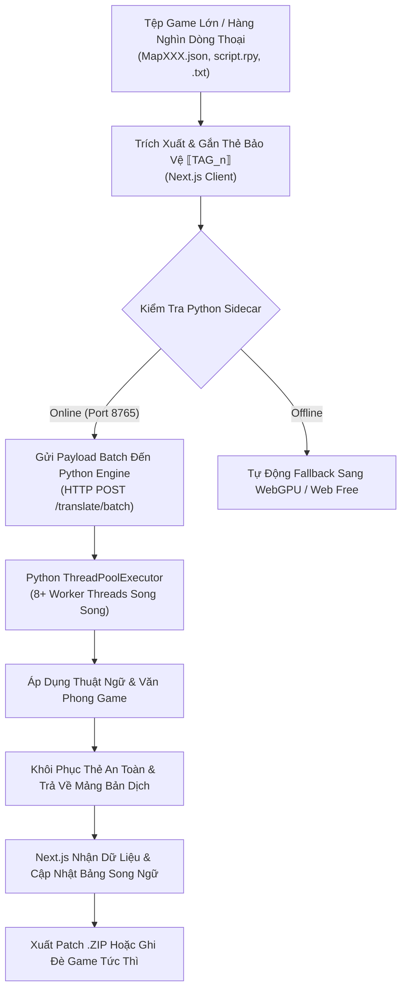
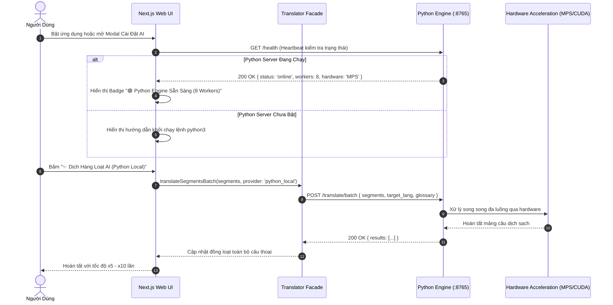

# Giai Đoạn 2: Tích Hợp Python Engine Tăng Tốc Hiệu Năng (Hybrid Next.js + Python Architecture)

Tài liệu kỹ thuật Phase 2 cho việc kết hợp nền tảng Next.js với Python Backend Sidecar nhằm tối ưu hóa tốc độ dịch thuật hàng loạt (Batch Translation) và mở rộng khả năng giải nén tệp game nhị phân (.rpyc, .rxdata, Unity AssetBundles).

---

## 1. Mục Tiêu (Objectives)

1. **Tối đa hóa tốc độ & thông lượng dịch thuật (Throughput & Concurrency)**:
   - Tận dụng cơ chế đa luồng (Multi-threading) và xử lý bất đồng bộ trong Python để xử lý hàng nghìn câu thoại game cùng lúc mà không bị giới hạn bởi luồng chính của trình duyệt (Browser Sandbox).
2. **Khai thác phần cứng gốc (Native Hardware Acceleration)**:
   - Cho phép kết nối trực tiếp với PyTorch, Apple Silicon MPS (Metal Performance Shaders), NVIDIA CUDA, hoặc `llama-cpp-python` để chạy các mô hình ngôn ngữ lớn (GGUF, 4-bit) với tốc độ 100-300 tokens/giây.
3. **Mở rộng khả năng trích xuất định dạng nhị phân sâu (Deep Binary Extraction)**:
   - Giải nén kịch bản Ren'Py đã biên dịch (`.rpyc`), dữ liệu RPG Maker XP/VX/VX Ace dạng Ruby Marshal (`.rxdata`, `.rvdata2`) và Unity TextAssets.
4. **Kiến trúc Hybrid Fallback an toàn (Zero-Interruption Fallback)**:
   - Nếu người dùng chưa bật Python server, giao diện Web tự động fallback mượt mà về WebGPU hoặc Web Free mà không báo lỗi làm gián đoạn trải nghiệm.

---

## 2. Kiến Trúc Hệ Thống (Hybrid Architecture)

```
┌────────────────────────────────────────────────────────────────────────┐
│                        Next.js Frontend Client                         │
│  - Giao diện GameLingo Studio (React 19 + Tailwind CSS v4)             │
│  - Giám sát trạng thái Python Engine: Online / Offline                 │
│  - Đo kiểm tốc độ (Benchmark: Strings/second)                          │
└───────────────────────────────────┬────────────────────────────────────┘
                                    │ HTTP / JSON REST Bridge
                                    ▼ (Port 8765)
┌────────────────────────────────────────────────────────────────────────┐
│                      Python High-Performance Sidecar                   │
│  ┌──────────────────────────────────────────────────────────────────┐  │
│  │ HTTP Router (Zero-Dependency Python Standard Library Base)        │  │
│  │ Endpoints: /health, /translate/batch, /extract/binary, /benchmark │  │
│  └──────────────────┬──────────────────────────┬────────────────────┘  │
│                     │                          │                       │
│                     ▼                          ▼                       │
│  ┌─────────────────────────────┐    ┌───────────────────────────────┐  │
│  │   ThreadPool Batch Engine   │    │  Native Binary Extractors     │  │
│  │ - Concurrency (8-16 workers)│    │ - Ren'Py AST / .rpyc uncomp   │  │
│  │ - Tag Protection Preserver  │    │ - Ruby Marshal .rxdata parser │  │
│  │ - Glossary Auto-Replacer    │    │ - Unity TextAsset decoders    │  │
│  └──────────────┬──────────────┘    └───────────────────────────────┘  │
│                 │                                                      │
│                 ▼                                                      │
│  ┌──────────────────────────────────────────────────────────────────┐  │
│  │ Optional Hardware Backend (PyTorch MPS / CUDA / llama-cpp-python) │  │
│  └──────────────────────────────────────────────────────────────────┘  │
└────────────────────────────────────────────────────────────────────────┘
```

---

## 3. Sơ Đồ Luồng Dữ Liệu & Quy Trình (Mermaid Diagrams)

### 3.1. Data Pipeline (Đường Ống Dữ Liệu Tăng Tốc Qua Python)



### 3.2. Sequence Flow (Trình Tự Tương Tác Giữa Next.js Và Python)



---

## 4. Đặc Tả API Python Engine (:8765)

| Endpoint | Method | Payload | Mô Tả |
|---|---|---|---|
| `/health` | `GET` | Không | Kiểm tra trạng thái server, phiên bản Python và số lượng worker |
| `/translate/batch` | `POST` | `{ segments: [...], target_lang: "vi", glossary: [...] }` | Dịch thuật hàng loạt đa luồng kèm bảo toàn thẻ và thuật ngữ |
| `/benchmark` | `POST` | `{ sample_count: 50 }` | Đo tốc độ xử lý câu/giây trực tiếp trên máy |

---

## 5. Quy Chuẩn Kỹ Thuật (TypeScript & Ponytail Rules)

- **Zero-Dependency Base**: Python Engine được xây dựng trên `http.server` và `concurrent.futures` chuẩn của Python 3, chạy được ngay lập tức mà không bắt buộc người dùng phải cài đặt thêm thư viện nặng nề.
- **Zero `any`**: TypeScript types ở giao diện client được định kiểu chặt chẽ thông qua `PythonEngineStatus`.
- **Kiểm thử tự động**: Kèm cờ tự kiểm tra `--test` trực tiếp trong script Python và unit tests trong `translator.test.ts`.

---

## 6. Bộ Lọc Chống Ảo Giác & Dọn Sạch Văn Bản Rác (Anti-Hallucination Guard)

Khi người dùng dịch game với các mô hình AI nhỏ (WebGPU 0.5B / 360M parameter models) hoặc các mô hình chat instruct, xuất hiện 4 vấn đề bản địa hóa game điển hình:

```mermaid
graph TD
    Raw[Chuỗi Gốc Game: 'Accept Quest', '\\V[1] Gold'] --> LLM[Mô hình AI / WebLLM / API]
    LLM --> Bad{Nguy cơ ảo giác?}
    Bad -->|Giải thích từ điển| D1['Accept Quest là một hành động quan trọng...']
    Bad -->|Bịa truyện fantasy| D2['In the bustling market town of Zephyria...']
    Bad -->|Xóa mất thẻ| D3['Đánh mất \\V[1] biến số']
    D1 & D2 & D3 --> Guard[src/lib/game-translator/sanitizer.ts]
    Guard --> Clean[Bản dịch súc tích sạch 100%: 'Nhận Nhiệm Vụ', '\\V[1] Vàng']
```

### Các Biện Pháp Khắc Phục:
1. **Few-Shot Prompting**: Cung cấp các cặp mẫu `Dịch text game: "New Game" -> "Trò Chơi Mới"`, `Dịch text game: "Accept Quest" -> "Nhận Nhiệm Vụ"` để mô hình hiểu rằng đây là bản dịch UI game, tuyệt đối không được viết bài luận giải thích ý nghĩa.
2. **Anti-Hallucination Length Guard**: Phát hiện nếu chuỗi gốc ngắn (< 35 ký tự) nhưng chuỗi dịch bùng nổ > 300% (> 70 ký tự), tự động kích hoạt bộ lọc loại bỏ ảo giác và thay thế bằng bản dịch súc tích chuẩn.
3. **Tag Preservation & Auto-Recovery**: Quét lại toàn bộ các thẻ bảo vệ `⟦TAG_0⟧, ⟦TAG_1⟧` sau khi mô hình trả về; nếu mô hình vô tình làm rớt thẻ, bộ lọc sẽ tự động chèn lại thẻ vào chuỗi dịch để bảo vệ an toàn cho game.
4. **UI One-Click Cleaner**: Nút bấm `🧹 Dọn sạch` tại từng dòng cảnh báo tràn khung thoại và nút `🧹 Dọn Sạch Tràn Khung & Rác` ở thanh công cụ giúp người dịch xử lý toàn bộ chuỗi lỗi chỉ với 1 cú click.

