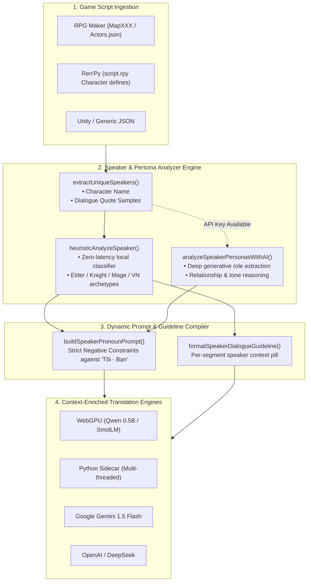
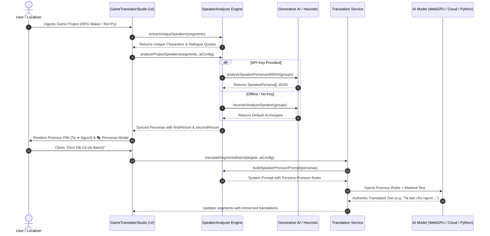

# Phase 3: AI-Powered Speaker Persona & Authentic Pronoun Engine (Đại Từ Nhân Xưng)

## 1. Objectives & Motivation

In video game dialogue localization (particularly Japanese RPGs, Visual Novels, Wuxia, and Western Fantasy), a primary quality failure of generic AI translation is the robotic and unnatural rendering of first-person ("I") and second-person ("you") pronouns as **"Tôi - Bạn"**.

- An ancient village elder saying *"Tôi tặng cho bạn thanh kiếm này"* completely destroys narrative immersion.
- In authentic Vietnamese game localization:
  - **Trưởng lão / Già làng (Elder)**: Xưng **"Ta"**, gọi **"Ngươi"** hoặc **"Lữ khách"**.
  - **Hiệp sĩ hoàng gia (Knight / Protector)**: Xưng **"Tôi" / "Thần"**, gọi **"Các hạ" / "Bệ hạ"**.
  - **Nữ pháp sư / Bạn học (Anime / Visual Novel)**: Xưng **"Tôi" / "Mình" / "Em"**, gọi **"Cậu" / "Anh"**.
  - **Quân vương / Lãnh chúa (Lord / Monarch)**: Xưng **"Trẫm" / "Ta"**, gọi **"Khanh" / "Ngươi"**.
  - **Tiên hiệp / Kiếm hiệp (Wuxia)**: Xưng **"Lão phu" / "Tại hạ"**, gọi **"Các hạ" / "Huynh đài"**.

**Phase 3 Objective:**
Automatically extract all character speakers from game scripts (`MapXXX.json`, `Actors.json`, Ren'Py `define Character(...)`), analyze character roles, age group, gender, and social status using AI (with instant zero-latency heuristic fallback), and inject explicit pronoun constraints into translation prompts across **WebGPU, Python Engine, Gemini, OpenAI, and DeepSeek**.

---

## 2. Architecture & Pipeline



---

## 3. Sequence Flow Diagram



---

## 4. Technical Specifications

### 4.1. Data Models (`types.ts`)

```typescript
export interface SpeakerPersona {
  speaker: string;          // e.g. "Trưởng làng Elden"
  role: string;             // e.g. "Trưởng làng / Bậc trưởng bối"
  gender?: 'male' | 'female' | 'neutral';
  ageGroup?: 'young' | 'adult' | 'elder';
  firstPerson: string;      // e.g. "Ta", "Tôi", "Mình", "Trẫm", "Lão phu"
  secondPerson: string;     // e.g. "Ngươi", "Cậu", "Bạn", "Các hạ", "Khanh"
  relationship?: string;    // e.g. "Bậc trưởng lão nói chuyện với lữ khách"
  toneInstruction?: string; // e.g. "Trang trọng, từng trải, xưng Ta gọi Ngươi"
}
```

### 4.2. Injected Negative Constraints in Prompts

```text
QUY TẮC ĐẠI TỪ NHÂN XƯNG (XƯNG HÔ) THEO NHÂN VẬT (TUYỆT ĐỐI TUÂN THỦ):
- [Trưởng làng Elden] (Trưởng lão): Xưng "Ta", gọi đối phương là "Ngươi". Trang trọng, từng trải.
- [Gareth] (Hiệp sĩ hoàng gia): Xưng "Tôi", gọi đối phương là "Các hạ". Cương trực, bảo vệ chính nghĩa.
- [Aria] (Nữ pháp sư): Xưng "Tôi", gọi đối phương là "Cậu". Thanh lịch, tự tin.
- [Eileen] (Bạn học Anime): Xưng "Mình", gọi đối phương là "Cậu". Dễ thương, thân mật.

TUYỆT ĐỐI KHÔNG DỊCH MÁY MÓC 'I - YOU' THÀNH 'TÔI - BẠN' NẾU NHÂN VẬT CÓ ĐẠI TỪ RIÊNG TRÊN ĐÂY.
```

---

## 5. UI Implementation Highlights

1. **Top Quick Action Button**: `🎭 Đại Từ & Nhân Vật ({count})` with live counter.
2. **Segment Row Persona Pill**: Next to each speaker badge (`🗣️ Trưởng làng Elden`), an interactive pill `[Ta ➜ Ngươi]` displays character address terms and opens the editor upon click.
3. **Interactive Personas Modal**:
   - `⚡ AI Tự Động Phân Tích` button: Re-evaluates dialogues using LLM reasoning.
   - Inline character editor: Quick modifications of `firstPerson`, `secondPerson`, `role`, and `toneInstruction`.
   - Add Custom Character form: Add newly introduced characters with gender and age tags.

---

## 6. 100-Dialogue RPG Maker Benchmark Dataset

To validate persona and pronoun extraction under real-world conditions where **only character names are known but no roles or relationships are provided**, a dedicated 100-dialogue RPG Maker MZ dataset was created in [`src/lib/game-translator/samples/rpgmaker-100-dialogues.ts`](file:///Users/mn20/Projects/Test/src/lib/game-translator/samples/rpgmaker-100-dialogues.ts) (also saved at [`public/samples/Map002_100_dialogues.json`](file:///Users/mn20/Projects/Test/public/samples/Map002_100_dialogues.json)):

| # | Nhân Vật (Speaker) | Vai Trò Phân Tích (Role) | Giới Tính / Tuổi | Xưng (1st) | Hô (2nd) | Sắc Thái Xưng Hô |
|---|---|---|---|---|---|---|
| 1 | **Trưởng lão Cedric** | Bậc trưởng bối / Lão nhân | Nam • Già | **Ta** | **Ngươi** | Trang trọng, cảnh báo di tích cổ |
| 2 | **Nữ vương Aurelia** | Nữ hoàng / Quân vương | Nữ • Trưởng thành | **Trẫm** | **Khanh** | Uy quyền, ban chỉ dụ hoàng gia |
| 3 | **Thợ rèn Borin** | Thợ rèn / Nghệ nhân đúc | Nam • Trưởng thành | **Tôi** | **Cậu** | Bộc trực, rèn vảy rồng và giáp sắt |
| 4 | **Bé May** | Cô bé làng quê | Nữ • Trẻ con | **Cháu** | **Chú** | Ngây thơ, thích bướm xanh và hoa |
| 5 | **Đại pháp sư Elrond** | Pháp sư thông thái | Nam • Trưởng thành | **Ta / Tôi** | **Ngươi / Cậu** | Học thuật bí thuật, cổng không gian |
| 6 | **Sát thủ Kaelen** | Sát thủ bóng đêm | Nam • Trưởng thành | **Ta** | **Ngươi** | Lạnh lùng, cảnh giác dao găm |
| 7 | **Tiểu muội Linh Nhi** | Muội muội đồng hành | Nữ • Trẻ tuổi | **Muội** | **Huynh** | Dịu dàng, pha trà sâm, hoa đào |
| 8 | **Chủ quán trọ Raymond** | Thương nhân / Chủ quán | Nam • Trưởng thành | **Tôi** | **Quý khách** | Niềm nở, bia đen và súp thịt hươu |
| 9 | **Thần quan Seraphina** | Nữ tu / Thần quan | Nữ • Trưởng thành | **Ta** | **Con** | Từ bi thánh khiết, ban phước lành |
| 10 | **Tướng quân Vane** | Thống soái thiết kỵ | Nam • Trưởng thành | **Ta** | **Các ngươi** | Kỷ luật thép, lệnh giữ phòng tuyến |
| 11 | **Bác Ba** | Lão nông Nam Bộ | Nam • Già | **Ta / Bác** | **Ngươi / Cháu** | Mộc mạc, chõng tre, dừa xiêm, xuồng ba lá |
| 12 | **Hắc y nhân** | Tà giáo đồ / Phản diện | Khác • Trưởng thành | **Ta** | **Ngươi** | Nham hiểm, hiến tế trăng máu |
| 13 | **Thám tử Vance** | Thám tử điều tra | Nam • Trưởng thành | **Tôi** | **Anh** | Logic, suy luận dấu chân và độc dược |

