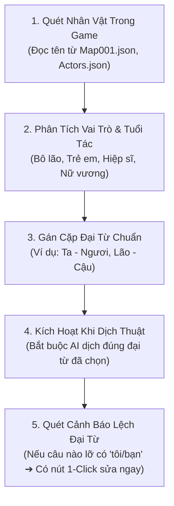

# Giai Đoạn 3: Nhận Diện Nhân Vật & Đại Từ Xưng Hô Tự Nhiên

> **Tóm tắt trong 1 câu (TL;DR):**  
> Tự động phân tích xem **"Ai đang nói chuyện với Ai"** để gán cách xưng hô chuẩn xác (Trưởng lão xưng *"Ta – Ngươi"*, Bé gái xưng *"Cháu – Chú"*, Nữ vương xưng *"Trẫm – Khanh"*), xóa sổ hoàn toàn lối dịch máy robot ngô nghê *"Tôi – Bạn"*.

---

## 1. 🛑 Vấn Đề Thực Tế (Trước Khi Có Hệ Thống Này)

Trong game RPG hoặc Visual Novel, tiếng Anh chỉ dùng hai từ đơn giản: **"I"** (tôi) và **"You"** (bạn). Khi đưa qua Google Dịch hoặc ChatGPT thông thường:

```text
❌ Cảnh 1: Một vị bô lão 80 tuổi nói với hiệp sĩ trẻ:
"Welcome to Eldoria village, brave traveler! I give you this sword."
➔ Dịch máy: "Chào mừng đến làng! Tôi tặng cho bạn thanh kiếm này."
(Nghe như hai đồng nghiệp văn phòng đang chào nhau, làm mất sạch không khí game kỳ ảo!)

❌ Cảnh 2: Một cô bé 7 tuổi nói với dũng sĩ:
"Mister! Did you see the giant butterfly? I picked these flowers for you!"
➔ Dịch máy: "Chào ông! Bạn có thấy con bướm không? Tôi hái hoa này cho bạn!"
(Mất hoàn toàn nét ngây thơ, đáng yêu của trẻ nhỏ).
```

---

## 2. ✨ Giải Pháp Của Chúng Ta (Sau Khi Có Hệ Thống)

Hệ thống tự động đọc hồ sơ nhân vật và gán cặp đại từ phù hợp theo từng bối cảnh:

| Nhân Vật Trong Game | Cách Dịch Máy Cũ ❌ | Cách Dịch Chuẩn Sau Khi Áp Dụng ✅ | Cặp Xưng – Hô |
| :--- | :--- | :--- | :--- |
| **Trưởng lão / Già làng (80 tuổi)** | *"Tôi tặng bạn thanh kiếm..."* | *"Lão tặng cậu thanh kiếm này..."* | **Lão / Ta** ➜ **Cậu / Ngươi** |
| **Bé gái ngây thơ (7 tuổi)** | *"Tôi hái hoa cho bạn..."* | *"Cháu hái hoa này cho chú nè..."* | **Cháu / Em** ➜ **Chú / Anh** |
| **Nữ vương uy quyền** | *"Tôi ra lệnh cho bạn..."* | *"Trẫm ban sắc lệnh cho dũng sĩ..."* | **Trẫm / Ta** ➜ **Ngươi / Dũng sĩ** |
| **Thợ rèn người lùn bộc trực** | *"Kiếm của bạn hỏng rồi, tôi sửa cho bạn."* | *"Gươm của nhóc mẻ hết rồi, để ta đập lại cho!"* | **Ta** ➜ **Nhóc / Cậu** |
| **Tiểu muội / Em gái** | *"Tôi luôn lo lắng cho bạn..."* | *"Muội luôn lo lắng cho huynh..."* | **Muội / Em** ➜ **Huynh / Anh** |

---

## 3. 🔄 Cách Hệ Thống Hoạt Động Trong 3 Bước Đơn Giản



1. **Bước 1 - Tìm tên người nói:** Hệ thống đọc tên Event trên bản đồ hoặc tệp danh sách nhân vật của game.
2. **Bước 2 - Phân tích vai vế:** Nhận diện nhân vật là ai (Bô lão già, Hiệp sĩ trung kiên, Bé gái ngây thơ hay Nữ vương).
3. **Bước 3 - Ràng buộc AI & Kiểm tra tự động:** 
   - Ép AI dịch theo đúng cặp xưng hô.
   - Nếu phát hiện câu nào còn sót từ *"tôi - bạn"*, hệ thống sẽ bật cảnh báo màu đỏ **"⚠️ Lệch đại từ"** và cung cấp nút bấm **"🪄 Sửa đại từ"** để tự động sửa ngay trong 1 giây.

---

## 4. 🎮 Hướng Dẫn Sử Dụng Trên Giao Diện

1. **Xem & Tùy Chỉnh Danh Sách Nhân Vật:**
   - Trên thanh công cụ, bấm nút **"🎭 Đại Từ & Nhân Vật"**.
   - Bảng nhân vật sẽ hiện ra: bạn có thể tự tay sửa từ xưng (Ví dụ: đổi từ *"Ta"* thành *"Lão"*) hoặc từ hô (đổi từ *"Ngươi"* thành *"Cậu"*).
   - Có thể bấm **"⚡ AI Tự Động Phân Tích"** để máy tự suy luận vai trò của toàn bộ nhân vật.
2. **Bật / Tắt Chế Độ "🎨 Tô Màu Đại Từ":**
   - Bấm nút **🎨 Tô Màu Đại Từ** trên thanh lọc.
   - Từ xưng (Ngôi 1) sẽ được tô màu **Tím**.
   - Từ hô (Ngôi 2) sẽ được tô màu **Xanh ngọc**.
   - Giúp bạn nhìn lướt qua là biết ngay nhân vật có xưng hô đúng vai vế hay không!
3. **Xử Lý Nhanh Khi Bị Lệch Đại Từ:**
   - Nếu thấy huy hiệu đỏ **"⚠️ Lệch đại từ"**, chỉ cần bấm nút **"🪄 Sửa đại từ"** cạnh câu đó để tự động chuẩn hóa.
   - Nếu muốn sửa toàn bộ cả dự án, bấm nút **"🪄 Khớp Đại Từ Chuẩn"** ở thanh trên cùng.

---

## 5. 💻 Dành Cho Lập Trình Viên (Cấu Trúc Mã Nguồn)

* **Bộ phân tích vai trò nhân vật:** [`src/lib/game-translator/speaker-analyzer.ts`](file:///Users/mn20/Projects/Test/src/lib/game-translator/speaker-analyzer.ts)
  * Hàm `extractUniqueSpeakers`: Gom nhóm các câu thoại theo từng người nói.
  * Hàm `heuristicAnalyzeSpeaker`: Phân loại vai trò tức thì (không tốn token AI) dựa trên từ khóa danh xưng và mẫu câu.
  * Hàm `analyzeProjectSpeakers`: Gọi AI phân tích sâu quan hệ và sắc thái nhân vật.
* **Bộ phát hiện và tự động sửa lệch đại từ:**
  * Hàm `hasPronounMismatch`: Nhận diện các câu dịch còn sót đại từ máy móc *"tôi - bạn"* chưa khớp với vai diễn.
  * Hàm `autoFixPronouns`: Thuật toán thay thế thông minh có nhận thức ngữ cảnh đầu câu (viết hoa) và vị trí từ.
* **Component tô màu trực quan:** [`src/components/game-translator/PronounHighlightedText.tsx`](file:///Users/mn20/Projects/Test/src/components/game-translator/PronounHighlightedText.tsx)
  * Tô màu real-time các đại từ xưng hô trong khung xem trước.
